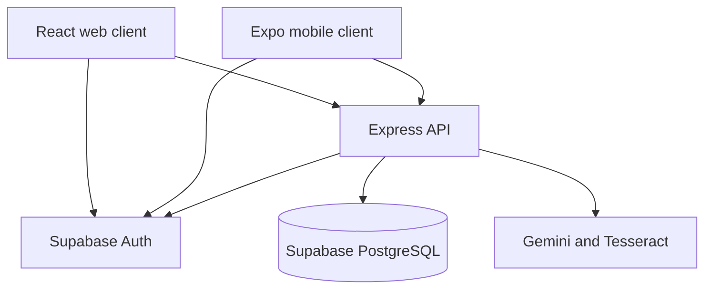

# Alalay

Alalay is a Filipino-first personal finance application for tracking income, expenses, bills, subscriptions, budgets, savings goals, wallets, loans, reports, and financial reminders. It includes a React web client, an Expo mobile client, an Express API, and a shared Supabase/PostgreSQL data layer.

<!-- Maintainers may add screenshots here when stable, repository-relative assets are available. -->

## Status

The web application and backend expose the broadest feature surface. The Expo mobile application is active development and shares the same Supabase project and API; its navigation and feature coverage do not yet mirror the web application completely.

## Contents

- [Features](#features)
- [Supported platforms](#supported-platforms)
- [Technology stack](#technology-stack)
- [Architecture](#architecture)
- [Repository structure](#repository-structure)
- [Data flow](#data-flow)
- [Prerequisites](#prerequisites)
- [Installation](#installation)
- [Environment configuration](#environment-configuration)
- [Database setup](#database-setup)
- [Running the project](#running-the-project)
- [Authentication configuration](#authentication-configuration)
- [API overview](#api-overview)
- [Testing and quality checks](#testing-and-quality-checks)
- [Build and deployment](#build-and-deployment)
- [Troubleshooting](#troubleshooting)
- [Contributing](#contributing)
- [Security](#security)
- [License](#license)

## Features

- Supabase email/password and Google authentication.
- Password reset, profile management, trusted devices, and authenticator-app TOTP verification.
- Dashboard summaries, reports, analytics, and financial trends.
- Income, expenses, bills, subscriptions, budgets, savings goals, wallets, transfers, and loans/debt.
- Notifications and scheduled financial reminders.
- AI chat and financial context through the backend’s Google Gemini integration.
- OCR-assisted receipt entry. Web OCR runs in the browser; mobile receipt images are sent to the authenticated backend for server-side processing and review.
- Responsive web UI and an Expo mobile application with light/dark theme support.

## Supported platforms

- Web browsers through Vite.
- Expo Go, Android, iOS, and Expo development builds for the mobile client.
- Node.js backend deployments that provide the required environment variables and HTTPS configuration.

## Technology stack

| Layer          | Technology                                                  | Purpose                                                             |
| -------------- | ----------------------------------------------------------- | ------------------------------------------------------------------- |
| Web            | React 19, TypeScript, Vite                                  | Browser application                                                 |
| Web styling    | Tailwind CSS and project CSS                                | Responsive interface styling                                        |
| Mobile         | React Native, Expo SDK 57, Expo Router                      | iOS, Android, and Expo web client                                   |
| API            | Express, TypeScript, Zod                                    | Authenticated application API and validation                        |
| Database       | Supabase PostgreSQL                                         | Shared application data, migrations, RLS, and database functions    |
| Authentication | Supabase Auth                                               | Email/password, Google OAuth, PKCE, password recovery, and TOTP MFA |
| AI             | Google Gemini through the backend                           | Chat and financial insights                                         |
| OCR            | `tesseract.js`                                              | Browser and server-side receipt text extraction                     |
| Validation     | Zod                                                         | Backend environment and request validation                          |
| Testing        | TypeScript, ESLint, SQL test scripts, workflow test scripts | Static, database, contract, and workflow checks                     |

## Architecture



Supabase Auth owns the authenticated identity and session. Protected web and mobile API requests send the caller’s Supabase access token to the Express API. The API validates the token, applies application rules, and reads or writes PostgreSQL through Supabase. AI and OCR providers are used only by the relevant backend or client flows.

## Repository structure

```text
frontend/   React/Vite web client
backend/    Express/TypeScript API
mobile/     React Native/Expo client
shared/     Shared TypeScript registries and definitions
supabase/   PostgreSQL migrations, local Supabase configuration, and SQL tests
tools/      Workflow and database test runners
docs/       Generated workflow and financial validation reports
```

| Path                             | Responsibility                                                 |
| -------------------------------- | -------------------------------------------------------------- |
| `frontend/src/App.tsx`           | Web route selection and authenticated shell                    |
| `frontend/src/pages/`            | Web authentication and application pages                       |
| `backend/src/services/server.ts` | Express middleware, health endpoint, and `/api` mounting       |
| `backend/src/routes/index.ts`    | Authenticated API route groups                                 |
| `mobile/src/app/`                | Expo Router screens and route layouts                          |
| `mobile/src/services/`           | Supabase, API, OCR, notifications, and authentication services |
| `supabase/migrations/`           | Ordered database schema and function migrations                |
| `supabase/tests/`                | SQL regression and workflow tests                              |

## Data flow

1. A user interacts with the web or mobile client.
2. The client authenticates with Supabase Auth and stores the resulting session using the platform-appropriate storage implementation.
3. Protected client requests call the Express API with a Supabase bearer token.
4. Backend middleware validates the token and establishes the request user identity.
5. Route handlers and services apply validation and business rules before reading or writing Supabase PostgreSQL.
6. AI and OCR integrations run only for the relevant features; OCR results require user review before an expense is created.
7. The API response is returned to the originating client.

The mobile client also uses Supabase directly for authentication and selected database-backed flows. `auth.users.id` is the authoritative identity; application profile data is stored in `public.users` with the matching UUID.

## Prerequisites

- Node.js 24.x and npm 11.x. The repository declares these versions in each workspace and `.nvmrc`; use `nvm use` where available.
- A Supabase project for hosted development, or the Supabase CLI and Docker for local database work.
- Expo Go for device testing, or Android Studio/iOS tooling for native emulators and development builds.

## Installation

Install each workspace independently:

```bash
cd frontend
npm install
```

```bash
cd ../backend
npm install
```

```bash
cd ../mobile
npm install
```

The repository root also contains shared test and formatting scripts. Install root dependencies before using them:

```bash
cd ..
npm install
```

## Environment configuration

Copy the relevant example file to `.env` in that workspace. Never commit populated `.env` files.

### Web: `frontend/.env`

| Variable                 | Required | Description                    | Example format                     |
| ------------------------ | -------- | ------------------------------ | ---------------------------------- |
| `VITE_SUPABASE_URL`      | Yes      | Supabase project URL           | `https://your-project.supabase.co` |
| `VITE_SUPABASE_ANON_KEY` | Yes      | Browser-safe Supabase anon key | `your-anon-key`                    |
| `VITE_API_URL`           | No       | Absolute backend base URL      | `http://localhost:3000`            |

Vite variables are client-visible. Do not place service-role keys or provider secrets in this file.

### Mobile: `mobile/.env`

| Variable                        | Required                   | Description                   | Example format                     |
| ------------------------------- | -------------------------- | ----------------------------- | ---------------------------------- |
| `EXPO_PUBLIC_SUPABASE_URL`      | Yes                        | Supabase project URL          | `https://your-project.supabase.co` |
| `EXPO_PUBLIC_SUPABASE_ANON_KEY` | Yes                        | Mobile-safe Supabase anon key | `your-anon-key`                    |
| `EXPO_PUBLIC_API_URL`           | Yes for API-backed screens | Reachable backend URL         | `http://192.168.1.50:3000`         |

On a physical device, do not use `localhost` for the backend URL; use a reachable LAN address, tunnel, or deployed API URL.

For EAS preview and production APKs, these public values must be configured in
the matching EAS environment before the build begins. `mobile/.env` is local
only and is not an EAS deployment mechanism. See
[`mobile/README.md`](mobile/README.md#public-supabase-build-configuration) for
the dashboard steps and `eas build` commands. Never add service-role keys or
other private credentials to `EXPO_PUBLIC_*` values.

### Backend: `backend/.env`

| Variable                         | Required                             | Description                               | Example format                            |
| -------------------------------- | ------------------------------------ | ----------------------------------------- | ----------------------------------------- |
| `PORT`                           | No                                   | Listen port; defaults to 3000             | `3000`                                    |
| `SUPABASE_URL`                   | Yes for Supabase-backed routes       | Supabase project URL                      | `https://your-project.supabase.co`        |
| `SUPABASE_ANON_KEY`              | Yes for caller-authenticated access  | Supabase anon key                         | `your-anon-key`                           |
| `SUPABASE_SERVICE_ROLE_KEY`      | Required for service-role operations | Server-only Supabase key                  | `your-service-role-key`                   |
| `GEMINI_API_KEY`                 | Required for Gemini features         | Server-only provider key                  | `your-gemini-key`                         |
| `GEMINI_MODEL`                   | No                                   | Gemini model name                         | `gemini-2.5-flash`                        |
| `GEMINI_THINKING_BUDGET`         | No                                   | Gemini thinking budget; defaults to 0     | `0`                                       |
| `CORS_ORIGIN`                    | No                                   | Comma-separated allowed browser origins   | `http://localhost:5173`                   |
| `APP_URL`                        | No                                   | Application URL                           | `http://localhost:5173`                   |
| `HTTPS_ENABLED`                  | No                                   | Enables HTTPS; required in production     | `false`                                   |
| `HTTPS_TERMINATE_LOCALLY`        | No                                   | Whether this process owns TLS termination | `false`                                   |
| `HTTPS_CERT_PATH`                | Only for local TLS                   | Certificate path                          | `./certs/server.crt`                      |
| `HTTPS_KEY_PATH`                 | Only for local TLS                   | Private-key path                          | `./certs/server.key`                      |
| `RESEND_API_KEY`                 | Optional                             | Email notification provider key           | `your-resend-key`                         |
| `EMAIL_FROM`                     | No                                   | Notification sender                       | `Alalay <guillermochristian19@gmail.com>` |
| `NOTIFICATION_SCHEDULER_ENABLED` | No                                   | Enables scheduled notifications           | `true`                                    |
| `BILLING_DEBUG`                  | No                                   | Enables billing diagnostics               | `false`                                   |

Keep `SUPABASE_SERVICE_ROLE_KEY`, `GEMINI_API_KEY`, `RESEND_API_KEY`, TLS keys, and production credentials server-side.

## Database setup

Database changes are SQL migrations under `supabase/migrations/`. Local configuration is in `supabase/config.toml` and targets PostgreSQL 17.

With the Supabase CLI and Docker available:

```bash
supabase start
supabase db reset
```

To apply migrations to a linked hosted project:

```bash
supabase link --project-ref your-project-ref
supabase db push
```

Review migrations before applying them to production. The schema includes RLS policies, Auth profile triggers, wallet/accounting functions, and financial workflow functions. `supabase/seed.sql` is intentionally empty so resets and SQL/RLS tests begin without fixture data.

The SQL test runner expects a running local container named `supabase_db_alalay`:

```bash
npm run test:db
```

## Running the project

Start the backend:

```bash
cd backend
npm run dev
```

The backend defaults to `http://localhost:3000`; its health check is `GET /health`.

### Backend container

The backend Dockerfile is provider-neutral and does not include Supabase, the
frontend, mobile application, or any environment file. Build from the repository
root so the root [`.dockerignore`](.dockerignore) is applied:

```bash
docker build -f backend/Dockerfile -t alalay-backend .
```

Run it by providing runtime values through your shell, an approved secret store,
or the hosting platform; never pass a committed env file into the image:

```bash
docker run --rm -p 3000:3000 --env-file backend/.env alalay-backend
```

The image runs as Node's unprivileged `node` user, listens on `PORT` (default
`3000`), handles `SIGTERM`/`SIGINT`, and checks the existing `GET /health`
endpoint. The image must receive production-valid backend configuration; see
[`backend/.env.example`](backend/.env.example). Docker Compose is intentionally
not supplied because Supabase's local stack is managed by the Supabase CLI.

### Render backend deployment

Use Render's **Native Runtime / Node** for the backend. This is the supported
default because the monorepo backend is self-contained and the native build can
explicitly compile TypeScript before startup. Do not select Docker unless the
Render Docker settings use the repository root as the build context; the
[`backend/Dockerfile`](backend/Dockerfile) intentionally copies `backend/...`
paths from that root.

For an existing Render web service, set these dashboard values:

| Setting           | Value                     |
| ----------------- | ------------------------- |
| Runtime           | Native Runtime / Node     |
| Root Directory    | `backend`                 |
| Build Command     | `npm ci && npm run build` |
| Start Command     | `npm start`               |
| Health Check Path | `/health`                 |
| Node Version      | `24.19.0`                 |

Also set the non-secret build variable `NPM_CONFIG_INCLUDE` to `dev`. This keeps
TypeScript and the other development-only build tools available to `npm ci` when
`NODE_ENV` is `production`; the service still starts only the emitted JavaScript.

Do not set `PORT`; Render supplies it and the server binds that port on
`0.0.0.0`. Production startup requires `NODE_ENV`, `HTTPS_ENABLED`,
`HTTPS_TERMINATE_LOCALLY`, `APP_URL`, `CORS_ORIGIN`, `SUPABASE_URL`,
`SUPABASE_ANON_KEY`, `SUPABASE_SERVICE_ROLE_KEY`,
`INCOME_SCHEDULER_SECRET`, `NOTIFICATION_SCHEDULER_ENABLED`, and
`IN_PROCESS_SCHEDULERS_ENABLED`. `BILLING_DEBUG` is an optional operational
flag. Gemini additionally uses `GEMINI_API_KEY`, `GEMINI_MODEL`, and
`GEMINI_THINKING_BUDGET`; outbound email uses `RESEND_API_KEY` and `EMAIL_FROM`.
The provider credentials are required only when those features are enabled. Use
Render's secret store for credentials; do not upload `backend/.env`.

The root [`render.yaml`](render.yaml) encodes these values for a _new_, suggested
`alalay-backend` Blueprint service. A Render service originally created in the
dashboard does not automatically adopt a newly added or changed Blueprint. Do
not assume that committing `render.yaml` updates such a service: either
explicitly migrate/sync it as a Blueprint or enter the Runtime, Root Directory,
Build Command, Start Command, Health Check Path, Node Version, and
`NPM_CONFIG_INCLUDE` setting above in that service's dashboard. Retain its
intended branch and existing auto-deploy policy unless the release owner
explicitly changes them.

The backend build verifies that `dist/index.js` exists, matches the production
start command, boots under Node without `tsx`, passes `/health`, and shuts down
cleanly on `SIGTERM` in Linux CI and Render. If a deploy reports a missing
`dist/index.js`, the build command did not run the
compile step in `backend`. If it reports a missing `typescript`, ensure the
Blueprint retains `NPM_CONFIG_INCLUDE=dev`. If startup fails before the health
check, check the environment-validation message for missing production HTTPS,
CORS, Supabase, or scheduler configuration.

Start the web client:

```bash
cd frontend
npm run dev
```

Use the URL printed by Vite and keep `VITE_API_URL` pointed at the backend. In local development use `http://localhost:3000`; production builds require an absolute HTTPS backend URL. Do not set it to a variable name or a relative path, because that sends API requests to the Vite server.

Start the mobile client:

```bash
cd mobile
npm start
```

Use Expo Go to scan the printed QR code. Native development builds use:

```bash
npm run android
npm run ios
```

Expo Go uses the generated `exp://.../--/auth/callback` deep link. Development and production builds use the configured `alalay` scheme and must be rebuilt after native configuration changes.

## Authentication configuration

Authentication uses Supabase Auth. The web client uses its current web origin for web callbacks. The mobile client uses `Linking.createURL('/auth/callback')`, PKCE, and `WebBrowser.openAuthSessionAsync` for native Google OAuth.

Configure these Supabase Authentication URL Configuration entries:

- Site URL (unchanged): `https://alalay-orpin.vercel.app`.
- Exact web callback: `https://alalay-orpin.vercel.app/auth/callback`.
- The exact Expo Go callback printed by the running app (do not guess it; the
  LAN host, tunnel, owner, and port can change), for example
  `exp://192.168.1.50:8081/--/auth/callback`.
- `alalay://auth/callback` for development and production builds.

Remove broad `alalay://**` entries when the exact native callback above is
accepted by the Supabase dashboard. Never replace the Site URL with an Expo
URL. Expo Go callbacks may need to be updated when the development URL changes;
an Expo development build is the stable OAuth test target.

For Google Cloud OAuth, the authorized redirect URI remains Supabase’s provider callback:

```text
https://your-project.supabase.co/auth/v1/callback
```

Do not add `exp://` or `alalay://` to Google Cloud. Supabase redirects from the provider callback to the client-specific `redirect_to` value.

Email confirmation and mobile password recovery use `mobile/src/app/auth/callback.tsx`.

## API overview

`GET /health` is public. All `/api` route groups require Supabase bearer authentication through backend middleware.

| Method                           | Endpoint              | Authentication | Description                                  |
| -------------------------------- | --------------------- | -------------- | -------------------------------------------- |
| `GET`                            | `/health`             | None           | Backend health check                         |
| `GET`, `POST`, `PATCH`, `DELETE` | `/api/bills`          | Required       | Bill management and payment flows            |
| `GET`, `POST`, `PATCH`, `DELETE` | `/api/expenses`       | Required       | Expense resources and receipt-linked entries |
| `GET`, `POST`, `PATCH`, `DELETE` | `/api/income`         | Required       | Income resources and summaries               |
| `GET`, `POST`, `PATCH`, `DELETE` | `/api/subscriptions`  | Required       | Subscription resources and billing data      |
| `GET`, `POST`, `PATCH`, `DELETE` | `/api/savings-goals`  | Required       | Savings goals and contributions              |
| `GET`, `POST`, `PATCH`           | `/api/budget`         | Required       | Budget summaries and planning                |
| `GET`                            | `/api/dashboard`      | Required       | Dashboard summaries and insights             |
| `GET`                            | `/api/reports`        | Required       | Reports and analytics                        |
| `GET`, `PATCH`                   | `/api/users`          | Required       | Profile and preferences                      |
| `GET`, `POST`                    | `/api/ai`             | Required       | Gemini status, chat, and streaming chat      |
| `POST`                           | `/api/ocr/receipt`    | Required       | Authenticated receipt OCR                    |
| `GET`, `POST`, `DELETE`          | `/api/trusted-device` | Required       | Trusted-device operations                    |
| `GET`, `POST`, `PATCH`, `DELETE` | `/api/wallets`        | Required       | Wallets, transfers, and adjustments          |
| `GET`, `POST`, `PATCH`           | `/api/loans`          | Required       | Loans, repayments, and debt workflows        |
| `GET`, `PATCH`                   | `/api/notifications`  | Required       | Notifications and preferences                |

The exact operations and validation rules are defined in `backend/src/routes/` and the corresponding services.

## Testing and quality checks

From the repository root:

```bash
npm run test:contracts
npm run test:workflows
npm run test:db
npm run format:check
npm run scan:encoding
```

Workspace checks:

```bash
cd backend
npm run typecheck
npm run build
npm start
```

```bash
cd frontend
npx tsc --noEmit -p tsconfig.json
npm run build
```

```bash
cd mobile
npx tsc --noEmit -p tsconfig.json
npm run lint
```

Database tests require the local Supabase container. The repository does not define a separate frontend lint or end-to-end test script.

GitHub Actions runs formatting, all workspace installs, backend and frontend
production builds, type checks, mobile lint, contract/workflow tests, production
dependency audits, a local Supabase migration plus SQL/RLS test job, and a secret
scan. It does not deploy.

## Build and deployment

Build the web client with `npm run build` from `frontend`. The backend's `npm run
build` emits production JavaScript to `backend/dist`, and `npm start` runs it with
Node; `npm run dev` remains the watch-mode TypeScript workflow. The mobile package
provides `expo run:android` and `expo run:ios` for native development builds; EAS
preview and production APK commands are documented in `mobile/README.md`.

Production backend configuration requires HTTPS according to `backend/src/config/env.ts`. Configure `APP_URL`, `CORS_ORIGIN`, Supabase credentials, and server-only provider keys in the deployment environment.

### Durable schedulers

Income schedules are posted by the database RPC `process_due_income_schedules`, which uses Manila calendar dates and an occurrence-key uniqueness constraint. Subscription billing and reminder delivery are separate idempotent jobs. In production, configure one durable external scheduler (or three platform cron jobs) to call:

```text
POST https://<api-host>/internal/scheduler/income
POST https://<api-host>/internal/scheduler/billing
POST https://<api-host>/internal/scheduler/notifications
x-scheduler-secret: <INCOME_SCHEDULER_SECRET>
```

Run income and billing at least every 15 minutes, and notifications at least hourly. All three endpoints use the Manila calendar date and are safe to retry. Billing writes immutable subscription expense occurrences; notifications derive their identity from those occurrences, so a delayed or out-of-order job can recover a missed renewal for up to seven days after `renewal_date` has advanced. Set a distinct, 24+ character `INCOME_SCHEDULER_SECRET` on the backend. In-process timers remain development-only and are not the production scheduling mechanism. Apply the database migrations before enabling these jobs.

### Release ownership and minimum checklist

The source of truth for each hosted system must be maintained by the release
owner; this repository does not contain provider credentials or deployment jobs:

- **Frontend (Vercel):** project linkage, preview/production public `VITE_*`
  variables, and Vercel deployment approvals.
- **Backend (Render native Node):** compiled Node release,
  server-only secrets, HTTPS termination, health checks, and CORS configuration.
- **Supabase:** hosted project, backups, remote migration history, Auth redirect
  allowlist, and production migration approval.
- **Scheduler:** exactly one durable scheduler, its private scheduler secret, and
  delivery monitoring.
- **Mobile (EAS):** EAS environments, Android signing credentials, and release
  artifact approval.

Before production release: pass CI; review the migration diff and remote history;
verify a recoverable database backup; apply migrations before dependent backend
code; set Vercel public values and backend server-only values in their respective
platform secret stores; verify HTTPS, `APP_URL`, and `CORS_ORIGIN`; build and
smoke-test the EAS artifact; then verify the three authenticated scheduler jobs.
See [`docs/deployment.md`](docs/deployment.md) for the full gated workflow.

## Troubleshooting

### The mobile API cannot connect

A physical device cannot reach a backend configured as `localhost`. Set `EXPO_PUBLIC_API_URL` to the machine’s LAN address, a tunnel, or a deployed API URL.

### Google OAuth returns to the web application

Check the mobile development log for the generated `redirectTo` and decoded `redirect_to` inside Supabase’s authorization URL. Expo Go requires the exact generated `exp://.../--/auth/callback` URL in Supabase. A native build uses `alalay://auth/callback`. Google Cloud should continue to use the Supabase callback URL.

### Email confirmation or password recovery does not return to mobile

Confirm that `mobile/src/app/auth/callback.tsx` exists, the generated Expo callback is allowlisted in Supabase, and the device is running the same Expo host and port used in the allowlist.

### The backend rejects startup configuration

Review `backend/.env.example` and the validation rules in `backend/src/config/env.ts`. Production requires `HTTPS_ENABLED=true` and HTTPS-compatible `APP_URL`/`CORS_ORIGIN` values.

### Database tests fail immediately

Start the local Supabase stack and confirm that the expected database container is running before executing `npm run test:db`.

## Contributing

There is no `CONTRIBUTING.md` in the repository. Keep application behavior, migrations, and documentation scoped to the task; run relevant workspace type checks, linting, tests, and formatting checks before review.

## Security

- Never commit `.env` files, service-role keys, provider keys, passwords, tokens, or TLS private keys.
- Keep Supabase service-role, Gemini, Resend, and TLS credentials on the backend only.
- Do not include financial records or authentication data in issue reports.
- Report suspected vulnerabilities privately to project maintainers rather than publishing credentials or exploit details.

## License

No `LICENSE` file is currently present, so the project’s license is not specified here.
